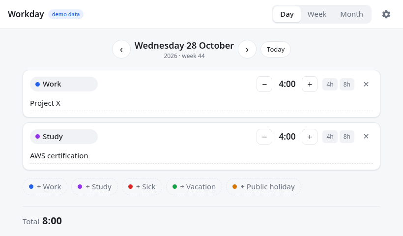
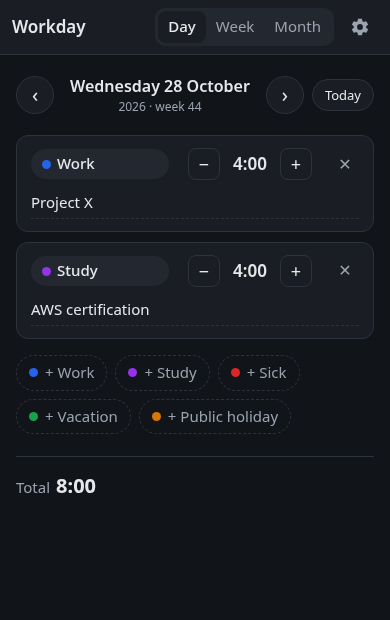

<p align="center"></p>

A minimal Home Assistant add-on for logging work hours in 15-minute steps.

<p align="center">
  
  
</p>

- Day view with ‹ › navigation (or arrow keys), categories, notes with autocomplete
- Week and month overviews, CSV export
- End-of-day reminder via any HA notify service, plus `sensor.workday_hours_today`
- Data stored in the official MariaDB add-on (part of HA backups)
- Login and access handled by Home Assistant Ingress; hours are kept per HA user

## Install

1. Install and start the **MariaDB** add-on.
2. *Settings → Add-ons → Add-on store → ⋮ → Repositories* and add
   `https://github.com/jer0enA/workday`.
3. Install **Workday**, start it and enable *Show in sidebar*.
4. Optional: configure the reminder on the add-on's *Configuration* tab.

Updates appear in Home Assistant when `version` in `workday/config.yaml` is bumped.

## Development

Artwork sources (SVG) are in `art/`.


```sh
# UI only, with in-browser demo data
cd workday/app/static && python -m http.server 8765

# Full stack with MariaDB
docker compose -f docker-compose.dev.yml up --build   # http://localhost:8099

# Tests
cd workday/app && pip install --require-hashes -r requirements.txt -r requirements-dev.txt && pytest
```

Dependencies are pinned with hashes. Edit `requirements.in` and regenerate with
`pip-compile --generate-hashes --strip-extras -o requirements.txt requirements.in`.

## Security

- Only accepts requests from the HA Ingress proxy; no exposed port.
- Runs as a non-root user; pip is removed from the image.
- Strict Content-Security-Policy, no third-party scripts or CDNs.
- CSV export neutralises spreadsheet formulas.
- CI: ruff (incl. bandit rules), pytest, pip-audit, hadolint, add-on linter
  and a Grype image scan; Dependabot keeps dependencies, the base image and
  Actions (pinned by commit SHA) up to date.
