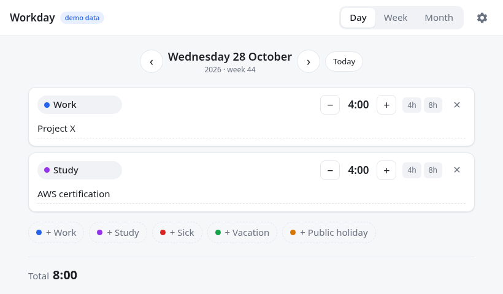
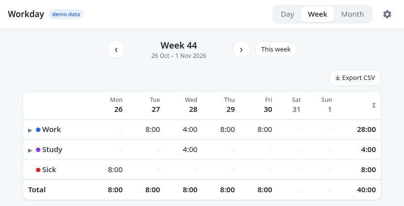
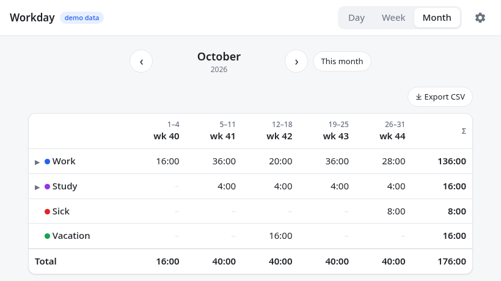

# Workday

_Log your working day in 15-minute steps — right inside Home Assistant._

No timers, no stopwatch: at the end of the day you simply fill in where your
hours went. _4 hours on Project X, 4 hours studying._ Done.

## Features

- **Quick day entry** — pick a category, tap `−` / `+` in 15-minute steps or
  use the `1h` / `4h` / `8h` shortcuts. Changes save automatically.
- **Categories** — Work, Study, Sick, Vacation and Public holiday out of the
  box; add, rename, recolor or archive your own.
- **Notes with autocomplete** — write down the project or topic; notes you
  used before are suggested as you type.
- **Browse days** — `‹` / `›` buttons or the arrow keys, plus a _Today_ button.
- **Week and month overviews** — totals per category and per day or week;
  expand a category to see the hours per note (e.g. per project).
- **Copy previous day** and **fill week** — log a normal day or a vacation
  week in one tap.
- **Contract hours and overtime** — see logged versus target hours per week and
  month, your running overtime balance and the workdays you still have to log.
- **Office or remote, km driven** — per day, with totals per week and month.
- **CSV export** — download the week or month you are looking at. Opens
  directly in Excel (`;`-separated, decimal comma).
- **End-of-day reminder** — get a notification on your phone at, say, 18:00
  when you have not logged your hours yet; skipped while you are on vacation.
- **Sensor** — `sensor.workday_hours_today` for your own automations.
- **Personal** — every Home Assistant user keeps their own hours and notes.
- **Live refresh** — hours logged on your phone appear on your laptop within
  seconds.
- **Light and dark mode**, works great in the companion app.

## Secure by design

- Only reachable through Home Assistant: your HA login protects it and no
  ports are opened.
- Data is stored in the official **MariaDB** add-on, so it is part of your
  Home Assistant backups.
- No external scripts, fonts or trackers; the app runs completely locally.

## Getting started

1. Install and start the **MariaDB** add-on (Settings → Add-ons → Add-on store).
2. Install **Workday** and start it.
3. Enable **Show in sidebar** and open _Workday_ from the sidebar.
4. Optional: set up the end-of-day reminder on the **Configuration** tab.

See the **Documentation** tab for all options and an example automation.

